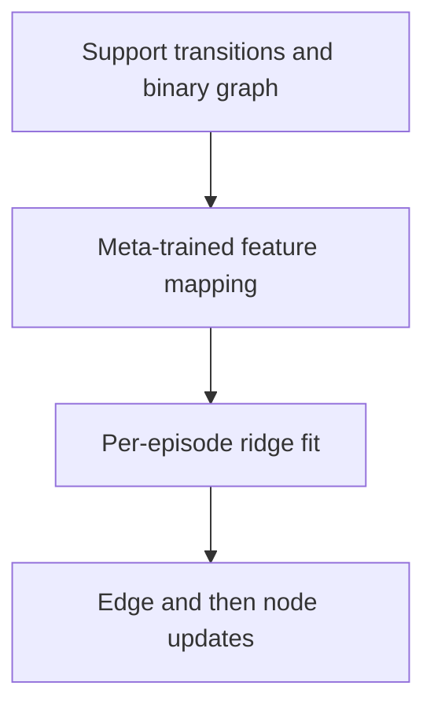

# Architecture

42,748 parameters; meta-trained feature mapping plus episode-specific ridge from eight support transitions, edge-to-node prediction.

## Data and model state

The archive includes the meta-trained E36 seed checkpoints, E34 data and frozen synthetic evaluation protocol.

## Implementation

[original guide](research/E36/README_RU.md) · [archived results](research/E36/E36_RESULTS/E36_METRICS.json) · [Model card](docs/MODEL_CARD.md)

`release.json` identifies the native directory and the exact commands executed by the launcher. The source tree contains the implementation, synthetic data or generators, historical protocols and experiment logs.
