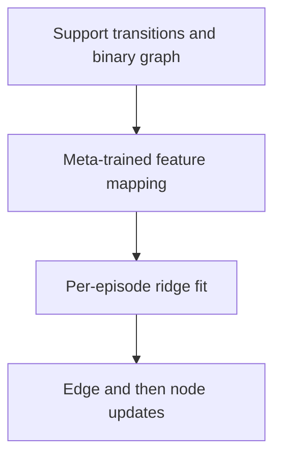

# INDUCT E36 — Meta-Ridge World Dynamics

[Русский](README_RU.md) · [Model card](MODEL_CARD.md) · [Releases](https://github.com/skatzrskx55q/twm-induct-e36/releases/tag/v0.1.0-research)

> Research prerelease · 0.1.0-research · **Positive known-law result; no promotion**

## Overview

42,748 parameters; meta-trained feature mapping plus episode-specific ridge from eight support transitions, edge-to-node prediction.

This release studies action-conditioned transitions in structured synthetic worlds. It predicts changes to the represented world state from the evidence specified by the native protocol. It can be used for controlled ablations and replication of transition or rollout experiments.

## Architecture



Full implementation and data flow are linked in [ARCHITECTURE.md](ARCHITECTURE.md).

## Historical benchmarks

Results come from the archived synthetic protocol. The [full benchmark record](BENCHMARKS.md) links the underlying artifacts.

| Experiment | Result | Reference |
|---|---:|---|
| Open dev L2 final H16 | 84/240 | — |
| Open dev L3 final H16 | 108/240 | — |

## Quick start

Linux x86-64 CPU, Python 3.13, and at least 1 GiB working space plus dependency space. [Installation and ZIP instructions](QUICKSTART.md).

```bash
git clone https://github.com/skatzrskx55q/twm-induct-e36.git
cd twm-induct-e36
python3.13 -m venv .venv
. .venv/bin/activate
python -m pip install torch==2.10.0 --index-url https://download.pytorch.org/whl/cpu
python -m pip install -r requirements.txt
python verify_integrity.py
python run.py check
python run.py --keep ../twm-induct-e36-demo demo
```

Run `python example.py` for a checkpoint-backed toy prediction. `python run.py demo` runs the original N2 benchmark.

## Training and reproduction

The native command trains the feature mapping and uses support transitions for the episode-specific ridge step.

```bash
python run.py --keep ../twm-induct-e36-training native -- e36_meta_ridge.py --steps 750 --seeds 17,29,43 --batch 16
```

[Original guide](research/E36/README_RU.md) · [Reproduction guide](docs/REPRODUCTION.md)

## Data and repository layout

The archive includes the meta-trained E36 seed checkpoints, E34 data and frozen synthetic evaluation protocol.

Archived data, source, checkpoints and metrics are inside `research/`. The root launcher copies the native tree before execution. `research_manifest.json` lists original SHA-256 hashes and `validation/` contains archived and release-time checks.

## Validation and limitations

`check` **PASS** · `demo` **PASS**. Selected checks exercise the documented native entry points. [Logs and environment](validation/linux-cpu.md).

Fixed binary graph and engineered features; no fresh sealed exam. Earlier seed17 retraining max weight diff 3.46e-6, not bitwise reproduction.

## TWM Research Series

[twm-induct-e34](https://github.com/skatzrskx55q/twm-induct-e34) · [twm-induct-structural](https://github.com/skatzrskx55q/twm-induct-structural) · [Series index](SERIES.md)

## License and citation

TWM-owned material uses [MIT](LICENSE). [Licensing and attribution](LICENSE_NOTICE.md) records source notices. Cite the research release with [CITATION.cff](CITATION.cff) and identify the archived benchmark and seed used.
