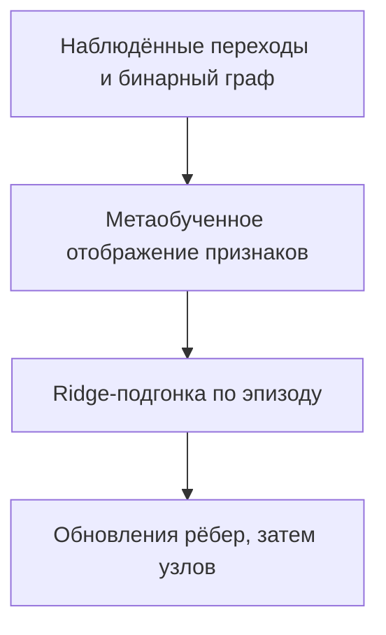

# INDUCT E36 — Meta-Ridge World Dynamics

[English](README.md) · [Карточка модели](docs/MODEL_CARD_RU.md) · [Релиз](https://github.com/skatzrskx55q/twm-induct-e36/releases/tag/v0.1.0-research)

> Исследовательский предварительный релиз · 0.1.0-research · **Положительный результат на известных законах; без продвижения**

## Обзор

42 748 параметров; метаобученное отображение признаков и внутриэпизодная ridge по восьми наблюдениям, прогноз рёбра→узлы.

В релизе исследуются переходы под действием команд в структурированных синтетических мирах. Модель предсказывает изменение состояния по наблюдениям, заданным исходным протоколом. Пакет предназначен для контролируемых абляций и повторения экспериментов с переходами или траекториями.

## Архитектура



Исходный код и схема работы описаны в [ARCHITECTURE.md](ARCHITECTURE.md).

## Исторические результаты

Показатели взяты из исторического синтетического эксперимента. [Описание результатов](BENCHMARKS.md) содержит ссылки на исходные материалы.

| Эксперимент | Результат | Контроль |
|---|---:|---|
| Открытый dev L2, конечное H16 | 84/240 | — |
| Открытый dev L3, конечное H16 | 108/240 | — |

## Быстрый старт

Linux x86-64 CPU, Python 3.13 и от 1 GiB рабочего места на диске плюс место для зависимостей. [Установка и запуск из ZIP](QUICKSTART.md).

```bash
git clone https://github.com/skatzrskx55q/twm-induct-e36.git
cd twm-induct-e36
python3.13 -m venv .venv
. .venv/bin/activate
python -m pip install torch==2.10.0 --index-url https://download.pytorch.org/whl/cpu
python -m pip install -r requirements.txt
python verify_integrity.py
python run.py check
python run.py --keep ../twm-induct-e36-demo demo
```

`python example.py` выполняет игрушечный прогноз с готовыми весами. `python run.py demo` выполняет исходный тест N2.

## Обучение и воспроизведение

Исходная команда обучает отображение признаков, ridge-подгонка в каждом эпизоде использует наблюдённые переходы.

```bash
python run.py --keep ../twm-induct-e36-training native -- e36_meta_ridge.py --steps 750 --seeds 17,29,43 --batch 16
```

[Исходное руководство](research/E36/README_RU.md) · [Инструкция по воспроизведению](docs/REPRODUCTION_RU.md)

## Данные и структура репозитория

В архиве есть веса метаобучения E36 для нескольких seed, данные E34 и зафиксированный синтетический протокол.

Исторические данные, код, веса и метрики лежат в `research/`. Перед запуском обёртка создаёт отдельную копию исходного дерева. В `research_manifest.json` записаны исходные SHA-256. В `validation/` хранятся архивные и новые проверки.

## Проверки и ограничения

`check` **PASS** · `demo` **PASS**. Выборочные проверки охватывают указанные исходные команды. [Журналы и окружение](validation/linux-cpu.md).

Заданы бинарный граф и признаки; нового закрытого экзамена нет. В предыдущем переобучении seed17 отличие весов до 3,46e-6, не побитное совпадение.

## TWM Research Series

[twm-induct-e34](https://github.com/skatzrskx55q/twm-induct-e34) · [twm-induct-structural](https://github.com/skatzrskx55q/twm-induct-structural) · [Каталог серии](SERIES.md)

## Лицензия и цитирование

Материалы TWM выпущены под [MIT](LICENSE). Исходное авторство указано в [лицензионных уведомлениях](LICENSE_NOTICE.md). Для цитирования релиза используйте [CITATION.cff](CITATION.cff) и указывайте исходный эксперимент и seed.
